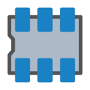
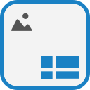

<div align="center">


# 🔌 KiCad‑iOS

### *The actual KiCad — running on iPad.*

**The real, upstream [KiCad](https://www.kicad.org/) 10.0.1, running on iOS / iPadOS.**
Not a recreation. Not a lookalike. The genuine program, compiled for Apple's tablets.

[](https://github.com/a-user-of-python/KiCad-IOS/actions/workflows/spike.yml)
[](LICENSE)
[](https://gitlab.com/kicad/code/kicad/-/tree/10.0.1)
[](#-installing)
[](#-installing)

**[🌐 Project website](https://a-user-of-python.github.io/KiCad-IOS/)** · **[⬇️ Get the release](https://github.com/a-user-of-python/KiCad-IOS/releases/tag/v0.7)**

</div>

---

> ⚠️ **Unofficial port.**
> This is an independent project. It is **not** affiliated with, sponsored by, or endorsed by the KiCad project or CERN. "KiCad" is a trademark of the KiCad project; the name is used here only to describe what this port is a port *of*. Every change to upstream code is documented in the open in [`MODIFICATIONS.md`](MODIFICATIONS.md).

---

## ✨ What it is

KiCad is the world's leading open-source electronics design suite — schematic capture, PCB layout, and a family of companion tools, all driven from one project manager. This repository ports the **actual upstream KiCad source code** (pinned at **10.0.1**) to iPad. Launch the app and KiCad's own **project manager** stands up; KiCad's **first-run wizard** runs exactly as it does on a fresh desktop install; every editor opens from the manager as a **real window** inside the one app process — KiCad's own menus, KiCad's own dialogs, KiCad's own buttons, driven by touch, Apple Pencil, keyboard, and mouse.

On a real iPad the manager opens, the wizard completes, projects create and open in the app's shared Documents folder, and the Schematic Editor draws on the software canvas — confirmed on hardware. Everything else on this page is a feature of the shipped build, verified in the shipped binary by the release gates; the full build-by-build history lives in the project report and the [releases](https://github.com/a-user-of-python/KiCad-IOS/releases).

## 🧰 The editors

Every tool in the manager's launcher column is present and opens in its own window:

| | Tool | What it does |
|---|---|---|
|  | **Project Manager** | The hub: project files tree, recent projects, and the launcher for every editor. Projects live in the app's shared **Documents** folder and move on and off the iPad the normal way. |
|  | **Schematic Editor** | Full schematic capture on the software (Cairo) canvas — the complete stock symbol libraries, wires, buses, hierarchy, annotation, and ERC. |
|  | **PCB Editor** | Board layout with the complete stock footprint libraries, routing, zones, and DRC, on the same software canvas. |
|  | **Symbol Editor** | Create and edit schematic symbols and libraries. |
|  | **Footprint Editor** | Create and edit PCB footprints and libraries. |
|  | **CvPcb** | Assign footprints to symbols. |
|  | **Gerber Viewer** | Inspect Gerber and drill output before fabrication. |
|  | **PCB Calculator** | Track widths, via sizes, electrical spacings, and the rest of the board-design calculators. |
|  | **Drawing Sheet Editor** | Design the title-block sheets schematics and boards are framed in. |
|  | **Image Converter** | Turn images into schematic symbols and PCB footprints (Bitmap2Component). |

**Libraries, bundled complete.** KiCad 10.0.1's **222 symbol libraries** and **155 footprint libraries** ship inside the app, unabridged, with the default library tables resolving straight to them — plus 19 project templates and the demo projects.

**Python, embedded whole.** KiCad's Python environment is in the app: the CPython 3.13 standard library, the compiled `pcbnew` module, KiCad's stock scripting plugins and footprint wizards, and two addons from the official PCM index — the PCBWay plug-in and the JLCPCB Fabrication Toolkit, each under its own license.

## 🖐️ Display & input

- **Real windows with titlebar controls.** Every window and dialog carries a titlebar strip at the top — title on the left, **Minimize** and **Close** on the right, Windows-style.
- **Draggable windows.** Drag a window by its titlebar strip. A maximised window un-maximises and follows the drag.
- **Full screen at desktop scale.** Windows open maximised and fill the display; the interface lays out the way it does on a desktop monitor, sized at 150% of the panel's raw pixel grid for readability. No black bars.
- **Dialogs keep their buttons.** A dialog's titlebar strip never resizes the dialog, so OK and Cancel stay inside the window no matter how many times it opens — and the strip passes taps through to the content beneath it everywhere except its own buttons.
- **Setup dialogs open on a real page.** Board Setup and Schematic Setup select their first page as they open — no waiting on a queued event — so Board Setup lands on its Layers page, ready to use.
- **Chooser panes keep their proportions.** Splitter positions restored from settings are validated against the live window size at the dialog's final size — and a saved position that arrives collapsed or pinned to an edge, including one banked by an older build on an upgraded install, resets to the intended split on first open, so the symbol and footprint choosers open with their tree, details and preview panes at usable widths.
- **Every window fits its display — inside the safe area.** Windows and dialogs are clamped to the live geometry of the display they are on — the app queries the display at runtime and hardcodes no resolution — and the clamp target is the display's safe area, so a dialog's top row (the choosers' filter field included) sits below the system status bar, visible and tappable, and Close and OK buttons stay reachable.
- **Field values take the on-screen keyboard.** Editing a symbol's value — or any custom field — in the field properties dialog uses a standard text field: tap it and the iOS keyboard rises, type, and OK applies the value, exactly like the dialog's other text boxes. The editor-style text fields behind the text and table-cell properties carry an input-method bridge that raises the keyboard for them and delivers its text as keystrokes.
- **Property dialogs open in front.** Quasi-modal dialogs — the component, field and text properties behind a double-tap — are shown and raised before their parent frame is disabled for the modal session, and chooser frames launched from inside a dialog detach from that dialog first, so a modal opens in front, fully enabled.
- **An app-wide audit behind it.** Every dialog's modal path, every persisted layout value, and the splitter restores in the fields-table dialogs, the Plugin and Content Manager, the design-block chooser, the simulator and the symbol/footprint viewers are validated against live sizes; "open externally" controls report the file's path when iOS refuses the launch instead of doing nothing.
- **Pinch zoom and two-finger pan.** In both the Schematic and PCB editors, a pinch zooms at its centre through KiCad's own view machinery, and a two-finger drag pans.
- **Smoother window moves.** Drag moves are coalesced and canvas resizes are deferred until the size settles, so moving a window doesn't redraw it a size at a time.
- **Virtual cursor (optional).** A **Cursor** toggle on every titlebar — off by default, remembered between launches — drives an on-screen arrow trackpad-style for precise canvas work; lifting the finger clicks at the arrow, and two-finger gestures pass through untouched.
- **Keyboard and mouse.** Full shortcut support (⌘ arrives as the Control modifier KiCad's bindings expect), mouse hover and crosshair tracking, right-click context menus, and scroll-wheel zoom, in both editors.
- **Software canvas.** The editors draw on KiCad's Cairo canvas — iPadOS has no OpenGL, and the editors never attempt it.

## 📲 Installing

The build is an unsigned `.ipa` (≈263 MB — the stock libraries ride along), sideloaded with your own signing.

1. **Download the IPA** from the project's [**Releases page**](https://github.com/a-user-of-python/KiCad-IOS/releases) — the [0.7 release](https://github.com/a-user-of-python/KiCad-IOS/releases/tag/v0.7). The same unsigned package is attached to every green run of the **Spike** workflow as the `kicad-spike-ipa` artifact.
2. **Sideload it** with a signer such as [Signulous](https://www.signulous.com/), or your own signing setup.
3. **Launch KiCad.** The first-run wizard walks through setup, and the project manager opens behind it. A fresh install is a supported path, and upgrading over an earlier build keeps projects and settings.

**Requirements:** an M‑series iPad running iPadOS 17 or later.

## 🧭 How it works

KiCad was never written for iOS. Four walls stand between its source code and an iPad, and the port has a concrete answer for each:

| # | The wall | The answer in this port |
|---|----------|-------------------------|
| 1 | KiCad's UI is built on **wxWidgets**, which has no iOS port. | **wxQt bridge** — KiCad's wx code runs on wxWidgets' Qt backend (wx 3.3.x), and Qt 6.9.3 runs natively on iOS. KiCad's own CMake already recognises a `qt` wx port. |
| 2 | KiCad's editors normally run as **separate processes** (Kiway). iOS apps are single-process. | **Single-process hosting** — each editor is a *kiface* module loaded in-process, opening as its own window inside the app. |
| 3 | **Python** scripting is baked into KiCad and its build requires it. | **A full CPython 3.13 sysroot is cross-compiled for iOS and embedded** in the app; the port sets its Python home at startup, so `import pcbnew` resolves to the real compiled module. |
| 4 | The drawing canvas is **desktop OpenGL**, which iOS doesn't provide. | **KiCad's built-in Cairo software canvas** carries the editors on iOS — correct rendering first; the GLU calls some 3D helpers expect are shimmed. |

Two more pieces of the foundation: a real **iODBC** is cross-compiled into the sysroot, so KiCad's database-library support is genuine code, not a stub; and the wx build is locked to the **shared sysroot libraries** (libpng / zlib / expat) — one copy of each in the whole bundle, so the icon pipeline loads KiCad's 5,000+ bitmap resources without conflict.

## ⚠️ Known limitations

- **The 3D viewer does not work.** It is bound to OpenGL, which this port does not have. The 2D editors are unaffected.
- **External display support is partial.** A window can be sent to a connected display and fills it at its native size (the **Ext** toggle on the titlebar) instead of mirroring — how much keyboard/mouse input iPadOS routes to a window on an external display is the open item.
- **ngspice codemodels are not bundled**, so some simulation device models are unavailable.
- **Oversized dialog content can clip.** A window always fits its display and stays closable, but content whose own minimum size exceeds the panel can clip inside a window that fits.

## 🛠️ Building

Builds run on free, standard GitHub Actions macOS runners (public repo) — nothing paid, ever.

```text
Actions → "Spike" workflow → Run workflow
```

The pipeline stages live in [`scripts/`](scripts/) and are deliberately staged so each part of the port builds — and is verified — separately:

1. `sysroot` — cross-compile the dependency sysroot for iOS arm64 (libpng, zlib, expat, iODBC, CPython, …).
2. `wx-ios` — build wxWidgets with the **Qt backend** against that sysroot; fails closed if a bundled third-party library sneaks in.
3. `kicad-ios` — compile upstream KiCad 10.0.1 with the port's patch series applied.
4. `package` — assemble the `.ipa`; audit symbol closure, Qt resources, libpng unity and signing before anything ships. The release gates inspect the shipped binary itself — the previous release is the failing control for every new check.

Every patch the port applies to upstream code is iOS-gated and recorded in [`MODIFICATIONS.md`](MODIFICATIONS.md).

## 📜 License & attribution

KiCad is free and open-source software, and so is this port.

- **License:** GNU General Public License v3.0 or later — the full verbatim text is in [`LICENSE`](LICENSE), taken unmodified from upstream KiCad.
- **Copyright:** KiCad is © its many contributors and the KiCad project; see [`NOTICE.md`](NOTICE.md) for attribution and the exact upstream baseline (KiCad 10.0.1, commit `2db9e5a7…`).
- **Headers:** upstream copyright & license headers in KiCad source files are never stripped or altered.
- **Changes:** every modification to upstream files is listed in [`MODIFICATIONS.md`](MODIFICATIONS.md) and carries a prominent change notice in the file itself, per GPL §5.
- **Libraries:** KiCad's symbol/footprint libraries carry their own license (KiCad Library License / CC BY-SA 4.0 with exception); they ship in the bundle under those terms.
- **Icons** on this page and the website are KiCad's own icon assets from the upstream source tree — the same artwork the app itself ships.

<div align="center">

*Built with respect for the KiCad project and its contributors.*
*KiCad runs on iPad — the real program, its real editors, its real libraries.*

</div>
